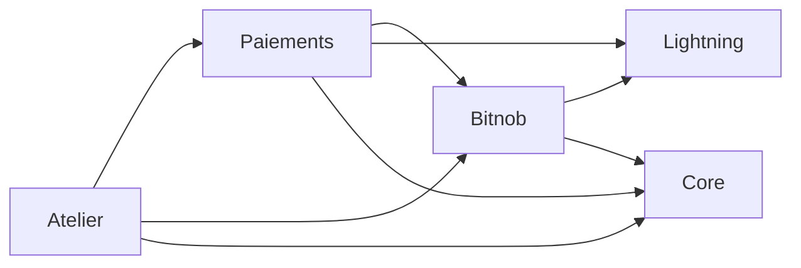

# Démo Bitnob Lightning

Une **interface unique** pour montrer tout le cycle d'un paiement Lightning avec
l'API [Bitnob](https://www.bitnob.dev) — pensé pour le workshop **Code & Chain Dakar** :

> **Invoice → QR → Webhook → Payout**

**Deux interfaces**, la même API — on passe de l'une à l'autre avec le
sélecteur en bas à droite (ou l'URL `#banc` / `#classique`) :

- **Banc** (par défaut) : la commande à gauche, au centre le **fil des
  échanges** — un diagramme de séquence des vraies requêtes navigateur ↔
  serveur ↔ Bitnob — et à droite l'**inspecteur** (en-têtes HMAC, corps JSON,
  vérifications, anatomie BOLT11). Boutons « Rejouer le webhook » et « Forger
  un faux webhook » : de vraies requêtes vers ton serveur. Mode projecteur
  pour grossir le texte.
- **Classique** : trois blocs sur une page :

| Bloc | Ce qu'on montre | Endpoint Bitnob utilisé |
|------|-----------------|--------------------------|
| 1. Facture | Créer une facture Lightning, l'afficher en QR / BOLT11, la voir passer à « payé » | `POST /api/lightning/invoices`, `GET /api/lightning/invoices/:id` |
| 2. Payout | Envoyer des sats à une facture Lightning (le chemin sortant) | `POST /api/lightning/pay` |
| 3. Journal | Les webhooks reçus : signature vérifiée, retries ignorés | `POST /api/webhook/bitnob` (notre route) |

## Arborescence

```
├── backend/ → l'API Laravel 12 + SQLite (le SEUL dossier à déployer)
│  ├── Modules/ → architecture modulaire (nwidart/laravel-modules)
│  │  ├── Core/ → repository de base, code admin, contrat TraceurInterface
│  │  ├── Lightning/ → le protocole : BOLT11 + secp256k1 (aucune base)
│  │  ├── Bitnob/ → le fournisseur : client HTTP (HMAC) OU faux Bitnob
│  │  ├── Paiements/ → factures, payout, webhook (les 3 vérifications)
│  │  └── Atelier/ → journal, fil des échanges, rejeu, /api/info
│  ├── modules_statuses.json → activer / désactiver un module
│  ├── public/spa/ → l'interface compilée (générée par npm run build)
│  └── .htaccess → redirige vers public/ si le domaine pointe sur backend/
├── src/ → l'interface Vue 3
│  ├── App.vue → choisit l'interface (#banc / #classique)
│  ├── views/Banc.vue → commande · fil des échanges · inspecteur
│  ├── views/Classique.vue → les 3 blocs : facture, payout, journal
│  ├── components/AnatomieBolt11.vue → la facture décortiquée
│  ├── lib/bolt11.js → décodeur BOLT11 du navigateur
│  ├── lib/api.js → appels à l'API (+ code admin)
│  └── styles/global.css → palette Sénégal (vert/jaune/rouge/sable)
├── vite.config.js → proxy /api → Laravel en dev, build → backend/public/spa
└── scripts/
   ├── smoke.mjs → test de bout en bout (mode simulation)
   └── paquet-hebergeur.sh → le zip prêt pour l'hébergeur (npm run paquet)
```

### Les modules

Chaque module suit la même structure : `App/{Entities, Http, Providers,
Repositories/{Eloquent,Interfaces}, Services/Interfaces}`, `Routes/api.php`,
`Database/Migrations`, `config/`. Les contrôleurs reçoivent des **interfaces**,
liées à leur implémentation dans le `ServiceProvider` du module.



| Module | Ce qu'il contient | Le point à montrer |
|--------|-------------------|--------------------|
| **Core** | `EloquentRepository`, `ExigerCodeAdmin`, `TraceurInterface` (+ `NullTraceur`) | les autres modules dépendent d'un **contrat**, pas d'Atelier |
| **Lightning** | `Bolt11CodecInterface`, `Secp256k1` | du pur protocole, réutilisable sans Bitnob |
| **Bitnob** | `BitnobClientInterface` → `HttpBitnobClient` **ou** `SimulationBitnobClient` | `MOCK_PAYMENTS` choisit l'implémentation dans le provider ; le faux Bitnob a **sa propre table** |
| **Paiements** | `FactureService`, `PayoutService`, `WebhookService`, middleware `AvancerLeTemps` | émet l'événement `WebhookTraite` |
| **Atelier** | `TraceurService`, `AtelierService`, listener `MemoriserDernierWebhook` | écoute `WebhookTraite` pour le rejeu, sans que Paiements le sache |

Désactive `Atelier` dans `modules_statuses.json` : les paiements marchent
toujours (le `NullTraceur` du Core prend le relais), seuls le journal, le fil
et `/api/info` disparaissent. Pour brancher un autre fournisseur (Strike,
LNbits…), il suffit d'un nouveau module qui implémente `BitnobClientInterface`.

Nouveau module : `php artisan module:make Tontine` (même structure `App/`).

## 1. Démarrer en mode simulation

Il faut **PHP ≥ 8.2** (avec `pdo_sqlite`), **Composer** et **Node ≥ 18**.

```bash
npm install
cd backend
composer install
cp .env.example .env          # MOCK_PAYMENTS=true : aucune clé, aucun argent
php artisan key:generate
touch database/database.sqlite
php artisan migrate
cd ..
npm run dev                   # API Laravel sur :8000, interface sur :5173
```

Puis ouvre `http://localhost:5173`, clique sur « Créer la facture » : ~2 s plus
tard, la facture est « payée », le webhook signé apparaît dans le fil, et tu
peux rejouer ce même BOLT11 dans l'onglet « Envoyer ». `npm run smoke` rejoue
tout ça automatiquement (avec `npm run dev` lancé dans un autre terminal).

En mode simulation, le serveur **fabrique lui-même le webhook** que Bitnob
aurait envoyé (signé avec le même HMAC-SHA512) et le fait passer par le **même
code de vérification** : on démontre la vraie mécanique, sans argent.

> PHP ne garde rien en mémoire entre deux requêtes (pas de `setTimeout`) : le
> « paiement » simulé a lieu à la première requête qui arrive après le délai —
> le polling de l'interface s'en charge. Pas de cron ni de worker à installer.

## 2. Brancher la clé Bitnob (sandbox)

1. Crée un compte sur [app.bitnob.com](https://app.bitnob.com) → **Settings → API Keys** :
  tu obtiens un **Client ID** et une **Secret Key** (l'API s'authentifie par
  signature HMAC, pas par une simple clé dans un header).
2. Renseigne dans `backend/.env` :

  ```bash
  MOCK_PAYMENTS=false
  BITNOB_CLIENT_ID=tonClientId
  BITNOB_SECRET_KEY=taSecretKey
  BITNOB_WEBHOOK_SECRET=secretDuWebhook  # renvoyé à la création du webhook
  ADMIN_TOKEN=unCodeLongEtAleatoire      # obligatoire pour le payout réel
  ```

3. Recharge la page : elle affiche désormais « Bitnob réel » et les factures
  sont de vraies factures BOLT11, payables par n'importe quel wallet.

La **sandbox** et la production partagent la même URL
(`https://api.bitnob.com`) : seule la clé change — ne mélange jamais les deux.

## 3. Déployer sur un hébergement mutualisé

Ce qu'il faut chez l'hébergeur : **PHP ≥ 8.2** avec `pdo_sqlite`, `mbstring`,
`openssl` (présents presque partout), Apache avec `mod_rewrite`. Pas besoin
de Node, de Composer, de base MySQL, de SSH, de cron ni de worker.

### Fabriquer le paquet

```bash
npm run paquet
```

Ça produit `deploiement/bitnob-demo-AAAAMMJJ-HHMM.zip` : interface compilée,
`vendor/` de production, base SQLite vide déjà migrée, et un `.env` de
production (clé neuve, `APP_DEBUG=false`, simulation activée, et un
**`ADMIN_TOKEN` aléatoire affiché à la fin** — note-le). Ton `backend/.env`
local n'est jamais copié.

### L'envoyer

1. Décompresse l'archive chez l'hébergeur (gestionnaire de fichiers ou FTP).
   Deux cas :
   - **Tu peux choisir le dossier racine du domaine** (le mieux) : mets le
     dossier à côté de `public_html` et pointe le domaine sur son `public/`.
   - **Tu ne peux pas** : mets le contenu directement dans `public_html`. Le
     `.htaccess` à la racine redirige tout vers `public/` et bloque `.env`, la
     base SQLite et les logs (vérifié : ils répondent 403).
2. Dans `.env`, remplace `APP_URL` par ton domaine.
3. Donne les droits d'écriture (775) à `storage/`, `bootstrap/cache/` et
   `database/` (SQLite écrit aussi un fichier temporaire à côté de la base).
4. Ouvre `https://ton-domaine/api/info` : tu dois voir `{"mock":true,…}`.

### Configurer le webhook Bitnob

Dans le dashboard Bitnob, crée un webhook avec l'URL
`https://ton-domaine/api/webhook/bitnob` (l'interface l'affiche en haut) et
copie son **signing secret** dans `BITNOB_WEBHOOK_SECRET`.

### Avant de mettre en ligne avec de vraies clés : `ADMIN_TOKEN`

Sans protection, n'importe qui connaissant l'URL pourrait appeler
`POST /api/pay` et **payer avec ton solde Bitnob**. Le paquet en génère un ;
pour en créer un à la main :

```bash
php -r "echo bin2hex(random_bytes(24)), PHP_EOL;"
```

| Variable | Effet |
|----------|-------|
| `ADMIN_TOKEN` défini | payout, fil des échanges, journal et rejeu exigent l'en-tête `x-admin-token`. L'interface affiche un champ « Code admin » (gardé le temps de l'onglet). |
| `MOCK_PAYMENTS=false` **sans** `ADMIN_TOKEN` | le payout est **refusé** (403) : un oubli ne laisse pas ton solde ouvert. |
| `DEMO_TOOLS=false` | coupe le fil des échanges et le rejeu de webhook (vraie production). |

Restent publics : la création de facture (on reçoit de l'argent), le statut
d'une facture et le webhook, protégé par sa signature HMAC.

## 4. Le flux, en schéma

```
  NAVIGATEUR (Vue 3)  SERVEUR (Laravel)  BITNOB / RÉSEAU
  ─────────────────  ─────────────────  ────────────────
  "Créer facture" ──────────▶ POST /api/invoices ──────────▶ POST /api/lightning/invoices
  ◀── { id, request(BOLT11) } ◀── (201)
  QR + BOLT11 ◀──────────────┘
  │
  │  …le payeur scanne et paie avec son wallet Lightning…
  ▼  réseau Lightning
  ◀── POST /api/webhook/bitnob ── Bitnob nous appelle
  vérifie x-bitnob-signature (HMAC-SHA512) 
  ignore si event_id déjà vu (idempotence) 
  marque la facture "paid" 
  statut "payé" ◀─────────── GET /api/invoices/:id (polling, filet de sécurité)
```

### Ce que le fil montre (interface Banc)

Le serveur trace chaque échange (table SQLite `echanges`) et les expose sur `GET /api/echanges` : le
navigateur ne fabrique rien, il affiche ce qui s'est réellement passé. En
simulation, les appels à Bitnob sont marqués **SIMULÉ** (le serveur montre
ce qu'il aurait envoyé) ; avec de vraies clés, ce sont les vraies requêtes.
Les signatures sont tronquées et la clé secrète n'est jamais tracée.
`POST /api/demo/rejouer-webhook` renvoie le dernier webhook authentique,
octet pour octet, pour démontrer l'idempotence.

## 5. Anatomie d'une facture BOLT11

Une facture `lnbc…` n'est pas un identifiant opaque : c'est un **message
signé**, encodé en bech32 (comme les adresses `bc1…`). L'interface la
décortique **dans le navigateur**, sans rien demander à personne
(survole chaque morceau coloré) :

```
lnbcrt 1500n 1 p4vla70 pp5… sp5… dq… xq… [signature] [checksum]
│      │     │ │       └─── champs étiquetés : p = payment_hash, s = payment_secret,
│      │     │ │            d = description, x = expiration…
│      │     │ └ horodatage de création
│      │     └ séparateur bech32
│      └ montant : 1500 nano-BTC = 150 sats  (m = milli, u = micro, n = nano, p = pico)
└ réseau : lnbc = mainnet, lntb = testnet, lnbcrt = regtest
```

À retenir :

- **La signature identifie le nœud destinataire** : on retrouve sa clé
  publique à partir de la signature, elle n'a pas besoin d'être écrite.
- **Le checksum** détecte une faute de frappe ou une facture tronquée.
- **Payer, c'est obtenir la preimage** : `payment_hash = sha256(preimage)`.
  Le destinataire ne révèle la preimage qu'en échange des sats — la détenir,
  c'est le **reçu**. L'interface fait la vérification une fois la facture payée.
- **On décode toujours avant de payer** : le bloc payout affiche montant,
  description, expiration et nœud, et refuse une facture illisible, mal
  signée ou expirée (`Bitnob::payerFacture()` fait la même vérification côté serveur, avec `app/Lightning/Bolt11.php`).

En mode simulation, les factures sont de **vraies factures BOLT11 signées**
(réseau regtest, par un « nœud de démo ») : tout décodeur les lit — par
exemple colle-en une dans [lightningdecoder.com](https://lightningdecoder.com).
Aucun wallet ne peut les payer, puisque ce nœud n'existe pas.

## 6. Sécurité — les 3 règles du webhook

1. **Signature** : chaque POST de Bitnob porte `x-bitnob-signature`
  (HMAC-SHA512 du corps brut avec ton signing secret). On compare en
  *constant time* et on **refuse tout le reste** (fail closed).
2. **Idempotence** : Bitnob renvoie un webhook jusqu'à 3 fois en cas d'erreur.
  Chaque `event_id` n'est traité qu'une fois, et chaque facture ne crédite
  qu'une seule fois.
3. **Côté serveur uniquement** : le navigateur ne déclare jamais un paiement.
  Il affiche, le serveur vérifie.

## 7. Points à vérifier dans la doc Bitnob

Ce que les docs officielles confirment clairement, et les deux détails à
re-vérifier dans le [playground](https://www.bitnob.dev/api-reference/lightning/play-ground)
avant un usage en production :

-  Auth HMAC : en-têtes `X-Auth-Client`, `X-Auth-Timestamp`, `X-Auth-Nonce`,
  `X-Auth-Signature` sur le message `CLIENT_ID:TIMESTAMP:NONCE:PAYLOAD`.
-  `POST /api/lightning/invoices` : `{ reference, amount(sats), description, expiry }`.
-  `GET /api/lightning/invoices/:id` : `data.status ∈ pending|paid|expired|failed`,
  `preimage` = preuve du paiement.
-  Webhook : `x-bitnob-signature` = HMAC-SHA512 du corps brut ; événement type
  `btc.lightning.received.success` ; retries avec le même `event_id`.
-  **Corps exact de `POST /api/lightning/pay`** : non détaillé dans la partie
  de doc lue — on envoie `{ invoice, reference }` (à confirmer au playground).
-  **Encodage de la signature webhook** : la doc dit HMAC-SHA512 sans préciser
  hex ou base64 — le module accepte les deux.

## 8. Forke et crée ta variante

5 idées pour transformer cette démo en vrai projet :

1. **Un power-up / une action de plus** : ajoute une route dans `backend/routes/api.php`
  (montant libre, description personnalisée) et affiche-la dans `src/views/Banc.vue`.
2. **Un autre domaine** : même cycle, autre vocabulaire — pourboire de restaurant,
  cagnotte d'équipe de foot, participation à une tontine. Les libellés sont dans `src/views/`.
3. **Une tontine** : chaque membre paie X sats, le serveur affiche la cagnotte et
  qui a payé ce mois-ci (une migration + un modèle Laravel, la base SQLite suffit).
4. **Un mur de pixels** : chaque webhook reçu allume un pixel d'une image partagée —
  c'est le webhook qui déclenche l'effet, jamais le navigateur.
5. **Un autre pays / une autre chaîne** : même démo avec une palette et des textes
  différents — le style est dans `src/styles/global.css` et dans chaque vue.

